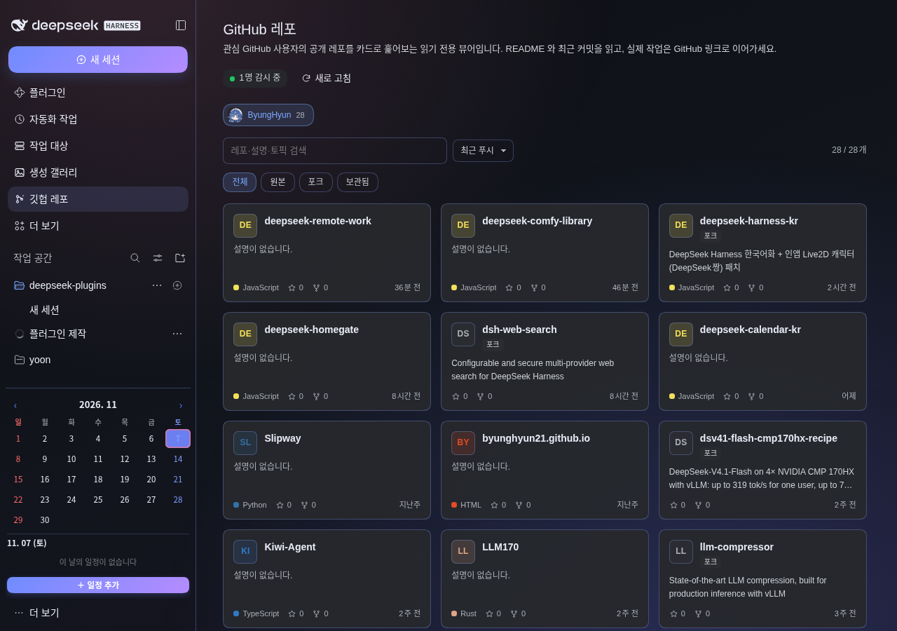
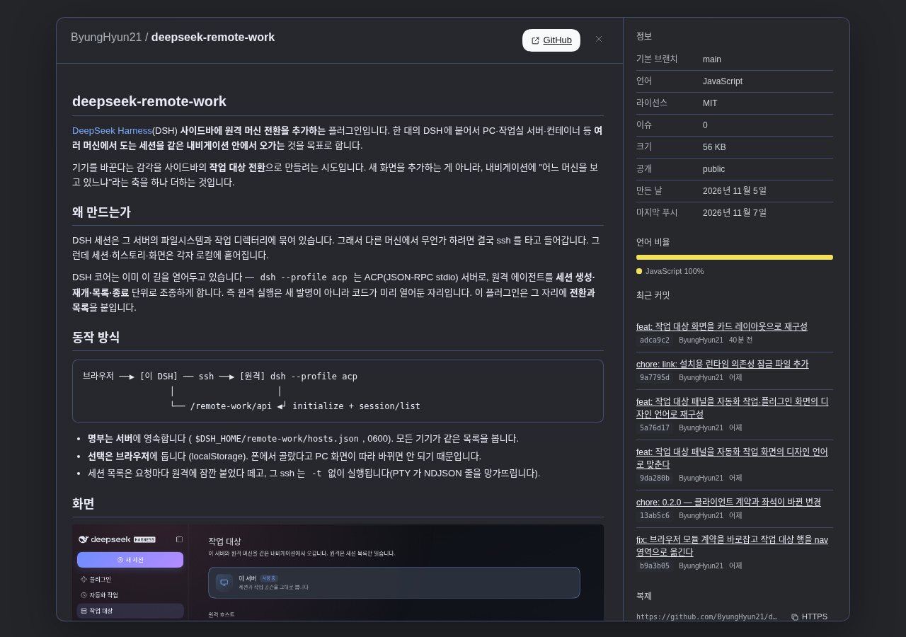
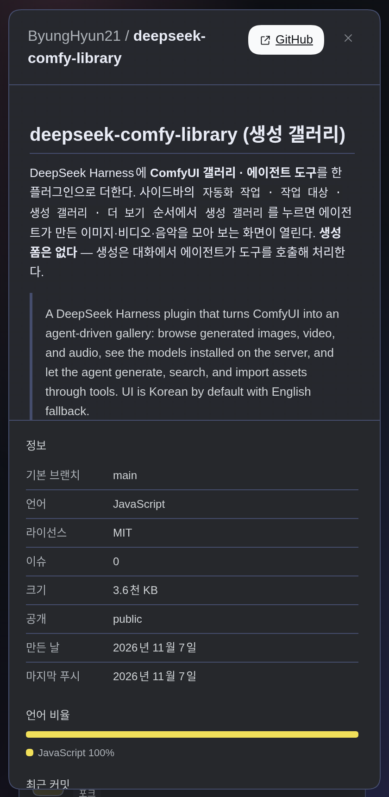

# deepseek-github-viewer (GitHub 레포)

DeepSeek Harness 사이드바에 **GitHub 레포 갤러리**를 더한다. 관심 있는 GitHub 사용자(개인·조직)를
설정에 등록하면 그 사용자의 공개 레포가 카드로 쌓이고, 카드를 누르면 README·최근 커밋·언어 비율을
읽을 수 있다. **읽기 전용 뷰어**다 — 레포 생성, 이슈, PR, 설정 변경은 카드의 GitHub 링크로 넘긴다.

> A read-only GitHub repository gallery for DeepSeek Harness. Register the GitHub users you follow,
> browse their public repositories as cards, read READMEs and recent commits, and jump to GitHub for
> any write action. The agent gets `github_repos` and `github_repo` tools.



## 설치

이 저장소가 곧 DSH 플러그인 패키지다. `web` 프로필에 설치한다.

```bash
git clone https://github.com/ByungHyun21/deepseek-git-viewer.git
cd deepseek-git-viewer
npm install --omit=dev
```

그다음 `plugin_manager` 의 `install_bundle` 로 이 디렉터리를 설치하고
`include:deepseek-github-viewer` 를 활성화한다. 설치는 `web` 프로필 전체에 적용된다.

- 요구 사항: Node.js 22.19 이상, DSH 0.2.x, GitHub REST API 접근
- 설정 위치: **플러그인 → GitHub 레포 → GitHub 레포 설정**
- 인증: 선택 사항. 토큰이 없으면 공개 데이터만 읽는다(시간당 60회).

## 설정

- **관심 GitHub 사용자**: 로그인 이름 또는 `https://github.com/<login>` 주소를 넣으면 된다.
  개인 계정과 조직 모두 가능하고, 여러 명을 등록할 수 있다.
- **GitHub 토큰 (선택)**: 비공개 레포까지 보거나 시간당 5,000회 한도를 쓰려면 PAT 를 넣는다.
  값은 이 프로필 설정에 저장되고, GitHub API 요청에만 쓴다.

## 화면

- **사용자 탭**: 등록한 사용자를 아바타와 함께 전환한다. 프로필 이름·공개 레포 수가 붙는다.
- **레포 카드**: 이름, 설명(2줄), 언어 색 점, 별·포크 수, 마지막 푸시(상대 시간), 토픽,
  `포크`·`보관됨` 배지. 언어별 색을 딴 이니셜 타일이 카드마다 붙는다.
- **검색·필터**: 레포 이름·설명·토픽 검색, `전체 · 원본 · 포크 · 보관됨`, 정렬
  `최근 푸시 · 별 많은 순 · 이름 순`.
- **자세히 보기**: README 를 마크다운으로 렌더링하고, 오른쪽 패널에 기본 브랜치·라이선스·크기·
  공개 여부·생성일·마지막 푸시, 언어 비율 바, 최근 커밋 6개, HTTPS/SSH 복제 주소를 보여 준다.
  README 안의 상대 경로 이미지와 링크는 `raw.githubusercontent.com` / GitHub blob 주소로 해석한다.
- **새로 고침**: 사용자 캐시를 비우고 GitHub 에서 다시 읽는다. 평소에는 10분 캐시를 쓴다.





## 에이전트 도구

| 도구 | 하는 일 |
|---|---|
| `github_repos` | 감시 중인 사용자(또는 지정한 로그인)의 공개 레포 목록. 검색·정렬·개수 제한 |
| `github_repo` | 레포 하나의 정보·README 텍스트·최근 커밋 6개·언어 바이트 |

둘 다 읽기 전용이고, 화면과 같은 호스트 함수를 공유한다.

## 설계 메모

- GitHub 호출은 호스트에서만 한다. 브라우저는 `/github/api/*` 만 본다. 토큰은 브라우저로 나가지 않는다.
- 사용자 프로필 30분, 레포 목록 10분, 레포 상세 5~10분 캐시. 토큰 유무에 따라 캐시 키를 나눈다.
- 조직은 `/users/<login>/repos` 가 비거나 404 면 `/orgs/<login>/repos` 로 한 번 더 시도한다.
- README 는 48KB 까지만 디코드하고, 마크다운은 React 노드로 직접 만든다
  (`dangerouslySetInnerHTML` 을 쓰지 않는다). README 에 섞인 ``·`<a>`·`<h1>` 같은
  간단한 HTML 은 마크다운으로 낮춘 뒤 렌더링한다.
- 레포 상세의 README·커밋·언어는 개별 실패를 빈 값으로 낮춘다. README 가 없어도 카드는 열린다.
- GitHub 한도를 다 쓰면 `429` 와 재설정 시각을 돌려주고, 화면은 한국어 안내를 띄운다.

## 한계

- 공개 레포만 기본이다. 비공개 레포는 토큰을 넣어야 보인다.
- GitHub REST 한도(무토큰 시간당 60회) 때문에 잦은 새로 고침은 피한다. 화면은 수동 새로 고침만 한다.
- 이슈·PR 목록, 코드 검색, 쓰기 동작은 없다. 필요하면 GitHub 링크로 이동한다.

## 개발

```bash
npm test        # 호스트 GitHub 클라이언트 + 마크다운 렌더러 회귀 테스트
npm run check   # 세 파일 문법 검사
```

테스트는 실제 GitHub 에 접속하지 않는다. `fetchImpl` 을 주입해 페이지네이션·조직 폴백·
README 디코드·한도 오류를 확인한다.

## 링크

- GitHub: <https://github.com/ByungHyun21/deepseek-git-viewer>

## 라이선스

MIT © 2026 ByungHyun21
